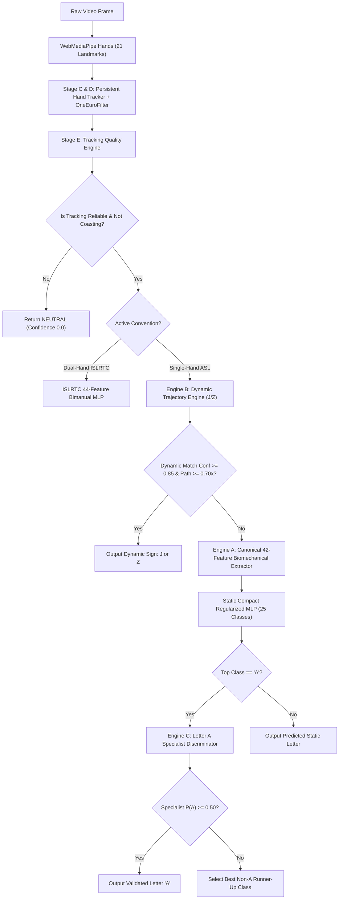

# SIGNBRIDGE — OPERATION ALPHABET MASTERY
## Unified 26-Class Inference Pipeline Integration Report

**Integration Target:** `frontend/src/services/alphabetInferenceEngine.ts`  
**Execution Environment:** Client-Side Browser WebAssembly / Web Workers  
**Supported Classes:** 26 ASL Alphabet Classes (A–Z) + NEUTRAL  

---

## 1. Unified Inference Pipeline Architecture

The SIGNBRIDGE inference pipeline coordinates multiple specialized inference engines into an integrated, deterministic decision tree:

---

## 2. Dynamic vs Static Arbitration Protocol

1. **Precedence Hierarchy:**
   - Tracking quality check has absolute veto: if landmarks are coasting or degenerate, output is `NEUTRAL` with confidence `0.0`.
   - Dynamic Trajectory Engine (Engine B) evaluates first. If an active stroke matches J or Z with path length $\ge 0.70 	imes 	ext{palmScale}$ and classifier probability $\ge 0.85$, the dynamic result is emitted immediately.
   - If dynamic conditions are not met, the pipeline defaults to the Static Biomechanical Engine (Engine A).
2. **Static Letter Protection:**
   - Stationary presentation of 'I' cannot trigger 'J' because cumulative trajectory displacement remains $< 0.20 	imes 	ext{palmScale}$ (below the 0.70 threshold).
   - Stationary presentation of 'D' cannot trigger 'Z' for the identical reason.
3. **Letter A Specialist Arbitration:**
   - When Engine A predicts 'A', Engine C (Letter A Specialist) executes a confirmatory forward pass with BatchNorm1d and calibrated temperature.
   - If Engine C confirms ($P(A) \ge 0.50$), 'A' is emitted.
   - If Engine C vetoes ($P(A) < 0.50$), 'A' is suppressed and the highest-scoring non-A class is selected, eliminating false positives from clenched fists or ambiguous thumbs.

---

## 3. Convention Isolation

- **ASL Single-Hand Chart:** Strictly constrained to 26 English alphabet letters (A–Z). Uses 42 canonical biomechanical features.
- **ISLRTC Dual-Hand:** Strictly constrained to Indian Sign Language two-handed alphabet standard. Uses 44 bimanual relative features.
- **Cross-Contamination Defense:** Separate weight files, separate class arrays, and distinct feature extraction pipelines guarantee that modifications to the ASL pipeline cannot alter ISLRTC inference.
