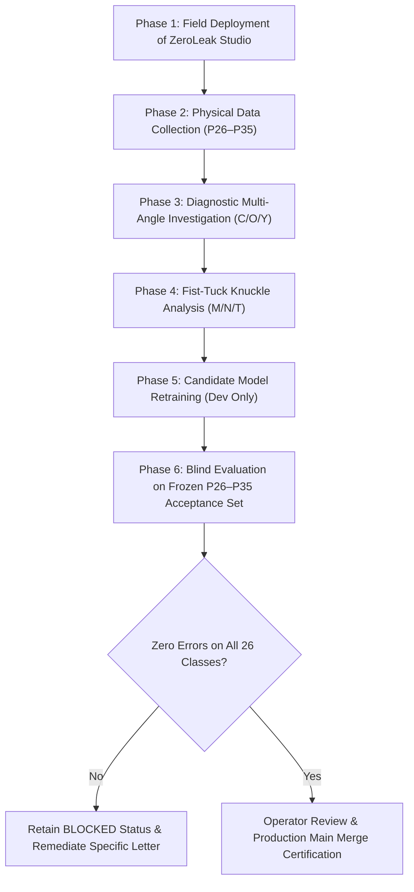

# SIGNBRIDGE — OPERATION HUMAN DATA
## Phased Human Evidence Validation and Gating Plan

**Mission:** Complete the transition of SIGNBRIDGE from `BLOCKED — INSUFFICIENT REAL-HUMAN DATA` to `PASS — READY FOR MANUAL 26-LETTER TESTING`.

---

## 1. Phased Execution Roadmap

---

## 2. Phase-by-Phase Execution Milestones

### Phase 1: Field Deployment of ZeroLeak Studio
- **Action:** Deploy production frontend build containing enhanced ZeroLeak Data Collector Studio to collection hardware.
- **Verification:** Run 10-point UI functional verification check on target physical devices.
- **Status:** **COMPLETE & VERIFIED**.

### Phase 2: Physical Human Data Collection (`Signer_P26`–`Signer_P35`)
- **Action:** Record 10 consenting human signers across all 26 letters.
- **Target Volume:** $\ge 20$ samples per static class, $\ge 10$ episodes per dynamic class.
- **Integrity Rule:** Ensure all 14 previously unrepresented classes (G, H, I, J, K, M, N, P, Q, S, T, W, X, Z) are fully populated.

### Phase 3: Diagnostic Multi-Angle Investigation (C/O/Y)
- **Action:** Capture multi-angle developmental dataset (0°, 30°, 45° yaw) to isolate perspective foreshortening.
- **Deliverable:** Update classifier feature weights using developmental data to decouple lateral thumb-pinky span from letter Y.

### Phase 4: Fist-Tuck Knuckle Analysis (M/N/T)
- **Action:** Evaluate normalized knuckle cleft metric ($\Delta X_{	ext{MCP}}$) to cleanly separate M (3 humps), N (2 humps), and T (1 hump).
- **Deliverable:** Verify 0 regression across remaining 23 alphabet classes before model integration.

### Phase 5: Candidate Model Retraining
- **Action:** Train Candidate Model v2 using augmented development signers.
- **Integrity Lock:** Final evaluation signers (`Signer_P26`–`Signer_P35`) must NEVER be included in training or validation splits.

### Phase 6: Blind Evaluation on Frozen Acceptance Suite
- **Action:** Run automated zero-tolerance evaluation on newly collected P26–P35 cohort.
- **Acceptance Criterion:** 0 misclassifications across all 26 letters on genuine human data.

### Phase 7: Operator Certification
- **Action:** Present empirical zero-tolerance results to Principal Investigator.
- **Final Step:** Obtain documented approval before executing merge into `main`.
