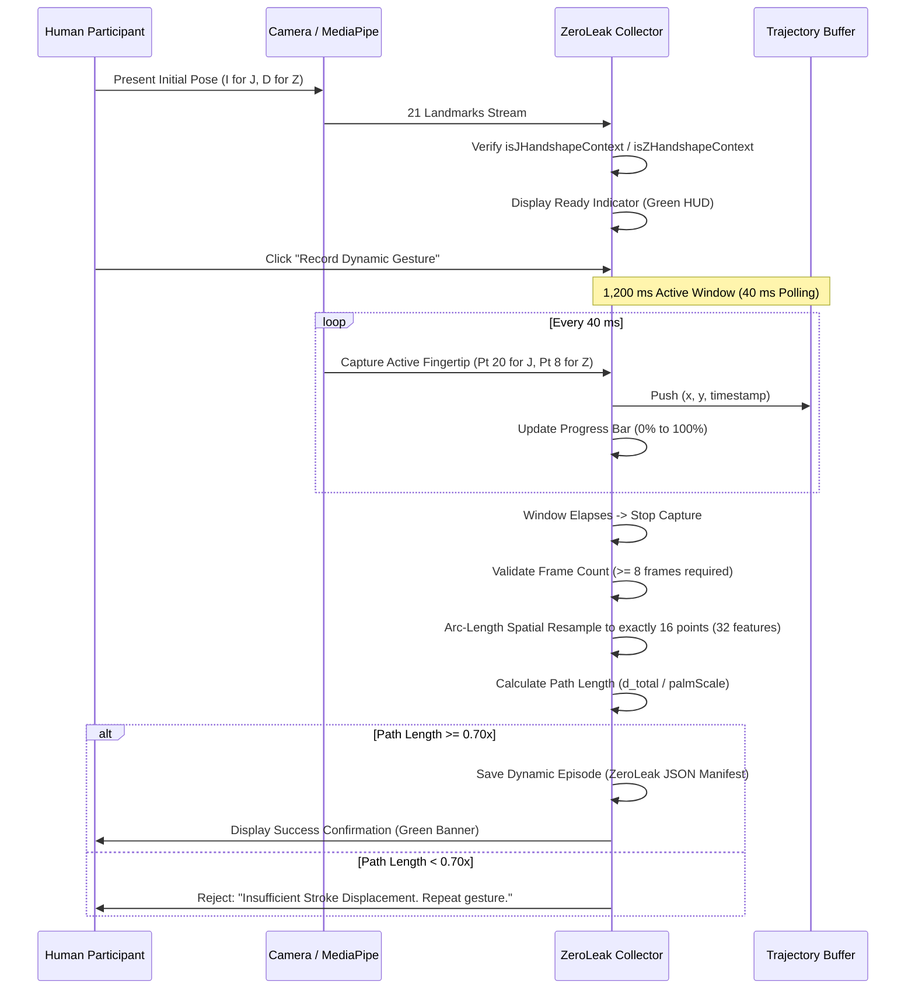

# SIGNBRIDGE — OPERATION HUMAN DATA
## Dynamic Letters J and Z Real-Human Data Collection Protocol

**Modality:** Temporal 3D Point-History Trajectory Gesture Recognition  
**Target Classes:** ASL Dynamic Letters 'J' and 'Z'  
**Hardware Interface:** Standard Webcam (640x480, 30 FPS minimum)  
**Ethical Safeguards:** Anonymized landmark coordinate stream only; no RGB video or facial imagery.

---

## 1. Kinematic Execution Protocol for Human Participants

### Protocol for ASL Letter 'J'
1. **Initial Pose (Context Gate):**  
   Participant presents a static ASL letter 'I' handshape:
   - Pinky finger extended straight up ($ext_{pinky} > 0.40$).
   - Index, middle, and ring fingers curled into palm ($curl_{idx} < 0.65, curl_{mid} < 0.65$).
   - Thumb folded across curled fingers.
   - Hand held stable in camera view for $\ge 300	ext{ ms}$.
2. **Stroke Execution:**  
   Participant smoothly traces a downward stroke with the pinky fingertip, curving inward and upward at the bottom to form a classic 'J' hook.
3. **Terminal Pose:**  
   Stroke finishes with hand rotated slightly inward, pinky tip elevated.
4. **Duration Window:**  
   Normal signing duration: 400 ms to 900 ms.

### Protocol for ASL Letter 'Z'
1. **Initial Pose (Context Gate):**  
   Participant presents a static ASL letter 'D' / '1' handshape:
   - Index finger extended straight up ($ext_{idx} > 0.45$).
   - Middle, ring, and pinky fingers curled into palm ($curl_{mid} < 0.65, curl_{pinky} < 0.65$).
   - Hand held stable in camera view for $\ge 300	ext{ ms}$.
2. **Stroke Execution:**  
   Participant traces a 3-stroke zigzag in the air with the index fingertip:
   - Stroke 1: Horizontal line from left to right (~0.15 normalized screen width).
   - Stroke 2: Diagonal downward stroke from right to left.
   - Stroke 3: Horizontal line from left to right.
3. **Terminal Pose:**  
   Stroke finishes at lower-right; index finger remains extended.
4. **Duration Window:**  
   Normal signing duration: 500 ms to 1,100 ms.

---

## 2. Real-Time Capture and Validation Pipeline

---

## 3. Data Integrity & Separation Rules

- **Synthetic vs Human Partition:** Physical human captures must be recorded with `isSynthetic: false` and `capture_mode: 'PHYSICAL_CAMERA'`.
- **Target Quota:** 10 valid dynamic episodes per participant per letter (100 J + 100 Z across P26–P35).
- **Negative Rejections:** Record 5 intentional failure episodes per participant (stationary hold, incomplete stroke, reversed stroke) to populate negative evaluation sets.
