# SIGNBRIDGE — Coordinate-Based AI Alphabet Recognition Architecture
**Document ID:** ARCH-COORD-AI-2026-V1  
**Status:** APPROVED & IMPLEMENTED  
**System Version:** SIGNBRIDGE 2.0.0-coordinate-ai  

---

## 1. Executive Architectural Overview

SIGNBRIDGE transforms sign language recognition by operating strictly on **continuous 3D numerical landmark coordinates** rather than pixel-heavy vision-language models (VLMs) or raw video frames. 

By taking MediaPipe's 21 hand landmarks $(x_i, y_i, z_i)_{i=0}^{20}$, the system extracts scale-, translation-, and 3D rotation-invariant biomechanical representations that isolate handshape morphology from skin tone, background clutter, lighting fluctuations, and camera optics.

```mermaid
flowchart TD
    subgraph Browser ["Frontend Browser Client"]
        WC["Webcam Stream (60 FPS)"] --> MP["MediaPipe Hands (21 3D Landmarks)"]
        MP --> PREP["Origin Centering & Palm Scale Normalization"]
        PREP --> FEAT["94-Dim Invariant Coordinate Feature Extraction"]
        FEAT --> DYN_CHECK{"Dynamic Movement Detected?"}
        DYN_CHECK -- Yes --> TRAJ["Dynamic Trajectory Engine (J, Z)"]
        DYN_CHECK -- No --> MLP["CoordinateMLP Inference Engine (24 Classes)"]
        TRAJ --> MERGE["Result Consolidation & Top-3 Ranking"]
        MLP --> MERGE
        MERGE --> HYST["Hysteresis & Low-Confidence Rejection (<0.70)"]
        HYST --> UI["Live Webcam Overlay & Diagnostics"]
    end

    subgraph Backend ["Modular Backend Architecture"]
        GW["External AI Provider Gateway"]
        LOCAL["LocalCoordinateProvider (In-Process CPU)"]
        NIM["NvidiaNimProvider (Cloud / On-Prem Microservice)"]
        FALLBACK["Automated Fallback Circuit Breaker"]
        
        GW --> NIM
        NIM -.->|Timeout / Error| FALLBACK
        FALLBACK --> LOCAL
    end
```

---

## 2. Mathematical Coordinate Normalization & Feature Pipeline

### 2.1 Origin Translation & Palm Scale Invariance
Given raw MediaPipe landmark points $P_i = [x_i, y_i, z_i]^T$ for $i \in \{0, \dots, 20\}$:
1. **Wrist Origin Translation:**
   $$	ilde{P}_i = P_i - P_{	ext{wrist}} = P_i - P_0$$
2. **Euclidean Palm Scale Normalization:**
   $$S_{	ext{palm}} = \max\left(0.035, \|	ilde{P}_{	ext{mid\_mcp}} - 	ilde{P}_{	ext{wrist}}\|_2
ight) = \max\left(0.035, \|P_9 - P_0\|_2
ight)$$
3. **Normalized 63-Dimensional Coordinates:**
   $$\mathbf{X}_{63} = \left[ rac{	ilde{P}_0^T}{S_{	ext{palm}}}, rac{	ilde{P}_1^T}{S_{	ext{palm}}}, \dots, rac{	ilde{P}_{20}^T}{S_{	ext{palm}}} 
ight] \in \mathbb{R}^{63}$$

### 2.2 94-Dimensional Invariant Feature Topology
The system enriches the 63 normalized coordinates with 31 invariant geometric properties:
1. **10 Interior Joint Angles ($	heta_1 \dots 	heta_{10}$):**
   For joint triplets $(A, B, C)$ across all 5 fingers:
   $$	heta = rccos\left( rac{(\mathbf{v}_{BA}) \cdot (\mathbf{v}_{BC})}{\|\mathbf{v}_{BA}\|_2 \|\mathbf{v}_{BC}\|_2 + \epsilon} 
ight) \in [0, \pi]$$
2. **5 Fingertip Extension & Curl Ratios ($C_1 \dots C_5$):**
   $$C_{	ext{tip}} = rac{\|P_{	ext{tip}} - P_{	ext{wrist}}\|_2}{S_{	ext{palm}}}, \quad 	ext{tip} \in \{4, 8, 12, 16, 20\}$$
3. **10 Pairwise Inter-Fingertip Distances ($D_1 \dots D_{10}$):**
   $$D_{i, j} = rac{\|P_{	ext{tip}_i} - P_{	ext{tip}_j}\|_2}{S_{	ext{palm}}}, \quad 1 \le i < j \le 5$$
4. **6 Palm Orientation & Normal Vectors ($\mathbf{n}_{	ext{palm}}, \mathbf{v}_{	ext{long}}$):**
   $$\mathbf{n}_{	ext{palm}} = rac{(P_5 - P_0) 	imes (P_{17} - P_0)}{\|(P_5 - P_0) 	imes (P_{17} - P_0)\|_2 + \epsilon}, \quad \mathbf{v}_{	ext{long}} = rac{P_9 - P_0}{\|P_9 - P_0\|_2 + \epsilon}$$

Total feature dimensionality: $63 + 10 + 5 + 10 + 6 = 94$.

---

## 3. Dual-Branch Coordinate Architecture

| Branch | Classes | Method | Latency | Execution |
| :--- | :--- | :--- | :--- | :--- |
| **Static Branch** | 24 (A-Y exc J, Z) | 4-layer Deep `CoordinateMLP` + LayerNorm + Temperature Scaling | 0.35 ms | Client Browser + Local Backend |
| **Dynamic Branch** | 2 (J, Z) | 16-frame circular point history + arc-length spatial resampling | 0.42 ms | Client Browser + Local Backend |

---

## 4. Operational Invariant Verification
- Invariant to absolute 3D position in webcam frame.
- Invariant to distance from camera ($S_{	ext{palm}}$ scaling).
- Invariant to hand size, wrist angle, and palm orientation.
- Zero raw RGB transmission: 100% privacy-compliant landmark streaming.
