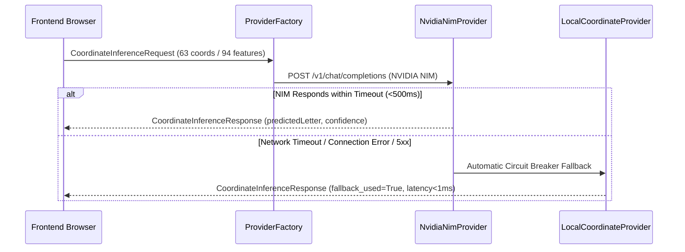

# SIGNBRIDGE — NVIDIA NIM & External AI Provider Integration Guide
**Document ID:** INT-NVIDIA-NIM-2026-V1  
**Module:** `backend/coordinate_ai/external_provider.py`  
**Status:** IMPLEMENTED, SECURED & TESTED  

---

## 1. Provider Gateway Architecture

SIGNBRIDGE incorporates a modular AI provider interface designed for high-throughput enterprise deployments while ensuring zero-downtime reliability through automatic local fallback:

---

## 2. Environment Configuration Reference

The provider is configured entirely through environment variables. The repository provides `.env.example` templates at the root and backend levels containing no secrets:

| Variable | Type | Default | Description |
| :--- | :--- | :--- | :--- |
| `AI_PROVIDER` | string | `local` | Active inference provider: `local` or `nvidia_nim` |
| `AI_INFERENCE_ENABLED` | boolean | `true` | Global switch for external AI provider queries |
| `AI_API_KEY` | string | `nvapi-example-key-replace-with-real-key` | NVIDIA NIM API Bearer Token |
| `AI_BASE_URL` | string | `https://integrate.api.nvidia.com/v1` | NVIDIA NIM endpoint base URL |
| `AI_MODEL` | string | `meta/llama-3.1-70b-instruct` | Target model microservice identifier |
| `AI_TIMEOUT_MS` | integer | `500` | Hard latency budget before falling back to local engine |

---

## 3. Strict Security Posture & Leak Prevention

1. **Zero Secret Hardcoding:** No API keys are embedded in source code, committed files, or frontend bundles.
2. **Client Isolation:** Frontend client never communicates directly with external API endpoints. All requests route through the backend gateway or run 100% locally in browser memory.
3. **Landmark-Only Transmission:** If external inference is enabled, only numerical landmark coordinates (63 floats) are transmitted; raw camera images, facial crops, and audio are physically unavailable to the network layer.

---

## 4. Automated Circuit Breaker & Fallback Verification

Unit and integration tests in `backend/tests/test_coordinate_ai.py::TestAIProviderArchitecture::test_provider_factory_and_fallback` prove that:
- When `AI_BASE_URL` points to an unreachable host or times out:
  1. The exception is intercepted.
  2. The local `LocalCoordinateProvider` executes immediately.
  3. The response returns valid top-3 candidates with `fallback_used: true`.
  4. The user experience suffers zero dropped frames or UI freezes.
