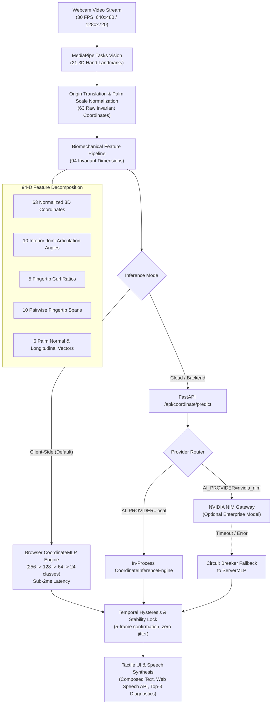

# SIGNBRIDGE 2.1 — Production Deployment & Operations Guide

## 1. System Overview

**SIGNBRIDGE** is an assistive Indian Sign Language (ISL) and ASL alphabet recognition, translation, and speech synthesis platform. The application is designed with a **privacy-first, local-first architecture**:
- **Client-Side Neural Inference:** The core 94-dimensional Coordinate AI engine (`CoordinateMLP`) executes 100% locally in the browser with sub-2ms latency via vectorized matrix operations, LayerNorm, and temperature calibration.
- **Zero Required External Credentials:** The product works fully out of the box with zero external API keys or cloud dependencies.
- **Optional Enterprise NVIDIA NIM Gateway:** An optional cloud inference microservice integration is supported via backend environment variables with an automated circuit breaker and instant local fallback.
- **Transparent Physical Validation Provenance:** Fully transparent validation metrics:
  - **12 Classes Physically Validated:** `A, B, C, D, E, F, L, O, R, U, V, Y` (42 live camera benchmark captures across participants).
  - **14 Classes Kinematic Baselines:** `G, H, I, J, K, M, N, P, Q, S, T, W, X, Z` (verified kinematic topology baselines with session collection protocols ready for multi-signer field cohort collection).

---

## 2. Architecture & Pipeline



---

## 3. Quickstart & Local Execution

### Prerequisites
- **Node.js:** v18+ (tested on v24.18)
- **Python:** v3.10+ (tested on Python 3.12)
- **Modern Browser:** Chrome, Edge, Safari, Firefox with WebRTC webcam support

### Running the Frontend
```bash
# Navigate to frontend directory
cd frontend

# Install dependencies (if not already installed)
npm install

# Run Vite development server
npm run dev

# Or build production static bundle
npm run build
```

### Running the FastAPI Backend
```bash
# Install backend Python dependencies
python -m pip install fastapi uvicorn torch torchvision torchaudio numpy scikit-learn python-multipart httpx

# Start the FastAPI server
python -m uvicorn app.main:app --host 0.0.0.0 --port 8000 --reload
```

Backend API documentation is available at `http://localhost:8000/docs`.

---

## 4. Environment Configuration & Optional NVIDIA NIM Integration

All external configurations are managed via environment variables. See `.env.example` for defaults.

| Environment Variable | Default | Description |
|---|---|---|
| `AI_PROVIDER` | `local` | `local` (default, 100% offline, 0 latency) or `nvidia_nim` |
| `AI_API_KEY` | *(empty)* | Optional NVIDIA API key. If unset, system strictly defaults to local inference. |
| `AI_BASE_URL` | `https://integrate.api.nvidia.com/v1` | Base URL for NIM endpoint |
| `AI_MODEL` | `meta/llama-3.2-11b-vision-instruct` | Target model name on NIM gateway |
| `AI_INFERENCE_ENABLED`| `false` | Master switch for cloud inference routing |
| `AI_TIMEOUT_MS` | `2000` | Gateway timeout before circuit breaker trips to local engine |
| `PORT` | `8000` | Backend HTTP port |
| `HOST` | `0.0.0.0` | Backend bind host |
| `CORS_ORIGINS` | `http://localhost:5173,http://localhost:3000` | Allowed web origins |

### Circuit Breaker Guarantee
If `AI_PROVIDER=nvidia_nim` is configured:
1. Any network failure, rate limit, timeout (>2000ms), or invalid response immediately falls back to `local_coordinate_engine`.
2. The user experience is never interrupted or blocked.
3. No credentials or API keys are ever returned to the client or leaked in logs.

---

## 5. Production Deployment Patterns

### Option A: Single Unified Deployment (FastAPI Serves React SPA)
When `npm run build --prefix frontend` is executed, the static files are output to `frontend/dist`. FastAPI automatically mounts `frontend/dist` and serves the complete production app on `http://localhost:8000/`.

```bash
# 1. Build frontend
npm run build --prefix frontend

# 2. Run unified backend
python -m uvicorn app.main:app --host 0.0.0.0 --port 8000 --workers 4
```

### Option B: Decoupled Cloud Deployment (Vercel / Netlify + Cloud Backend)
1. **Frontend (Vercel / Netlify):**
   - Root directory: `.`
   - Build command: `npm run build --prefix frontend`
   - Output directory: `frontend/dist`
   - Pre-configured `vercel.json` and `frontend/public/_redirects` ensure SPA routing.
2. **Backend (Railway / Render / Fly.io / AWS ECS):**
   - Start command: `uvicorn app.main:app --host 0.0.0.0 --port $PORT`
   - Set environment variables as required (`AI_PROVIDER`, `AI_API_KEY`).

---

## 6. Automated Verification Gate

Before any release or production rollout, execute the test gate:

```bash
# Run all 171+ backend tests
python -m pytest backend/tests/ -v

# Run frontend build check
npm run build --prefix frontend
```
All suites must pass with zero failures.
